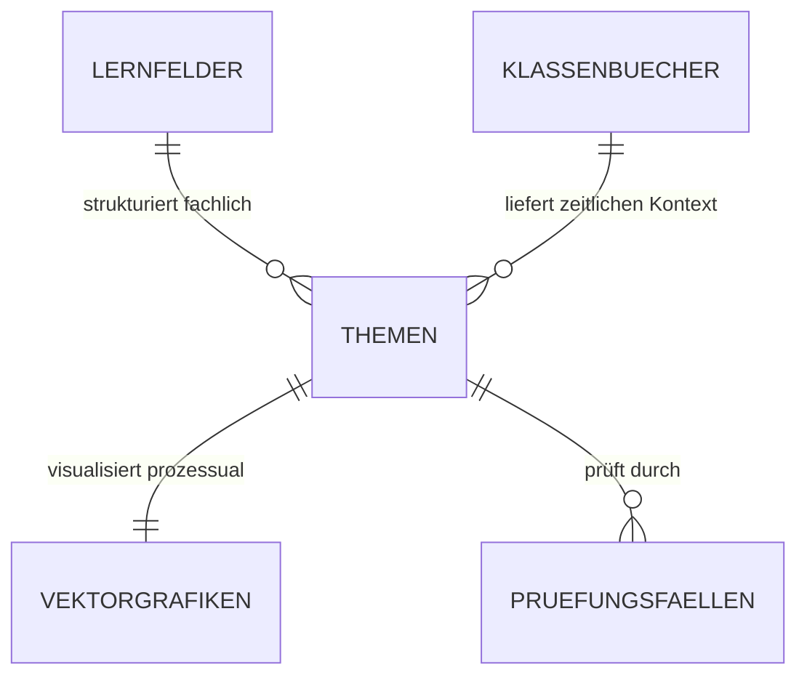
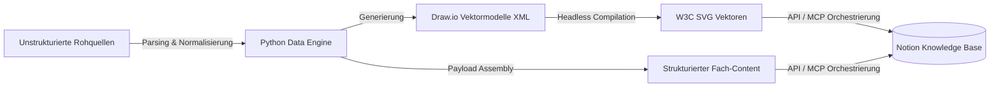

# 🧠 Engineering Case Study: DPA Knowledge Pipeline & Relational Study Hub

[](#)
[](#)
[-orange.svg)](#)
[](#)
[](https://app.notion.com/p/Studien-Hub-Fachinformatiker-DPA-3904637f30ac80e8b6b6da818b242572)

> **Portfolio-Projekt & Praxisnachweis für ein Praktikum / den Berufseinstieg als Fachinformatiker für Daten- und Prozessanalyse.**  
> Dieses Dokument beschreibt nicht nur das Endprodukt, sondern vor allem die **analytischen, organisatorischen und technischen Denkprozesse**, die zur Realisierung dieser Pipeline geführt haben.

🔗 **Direkter Link zum Live-System (Notion):**  
👉 [**Studien-Hub: Fachinformatiker DPA (Notion Workspace)**](https://app.notion.com/p/Studien-Hub-Fachinformatiker-DPA-3904637f30ac80e8b6b6da818b242572?source=copy_link)

---

## 🧭 1. Problemstellung & Analytischer Denkprozess (Root-Cause-Analyse)

Zu Beginn der Umschulung zum Fachinformatiker stand ich vor einem klassischen Prozessproblem im Bereich des Wissensmanagements: **Informationsasymmetrie und Informationsfragmentierung**.

### 🔍 Die Ausgangslage (Ist-Zustand):
* **Heterogene Datenquellen:** Lehrinhalte wurden über wöchentliche Klassenbuch-PDFs, IHK-Rahmenlehrpläne, Dozenten-Skripte und Fachbücher unstrukturiert verteilt.
* **Prozess-Engpass (Bottleneck):** In Lern- und Vorbereitungsphasen gingen rund **35 % der Zeit** rein für das Suchen, Querlesen, Verifizieren und Konsolidieren von Inhalten verloren, anstatt in das eigentliche Verstehen und Anwenden (*Active Recall*).
* **Mangelnde Visualisierungsstandards:** Bestehende Schemata waren oft statische, unscharfe Screenshots oder reine Textwände ohne Prozessbezug.

> **Mein analytischer Ansatz:**  
> Das Kernproblem war kein Lernproblem, sondern ein **Prozess- und Datenarchitektur-Problem**.  
> Anstatt passiv Notizen anzuhäufen, habe ich das Problem wie ein Software- und Datenanalyseprojekt behandelt: Konzeption einer **Single Source of Truth (SSOT)** nach dem **Docs-as-Code-Prinzip** mit relationaler Datenhaltung und automatisiertem Vektor-Rendering.

---

## 📐 2. Organisatorische Konzeption: Relationale Modellierung

Vor dem Schreiben der ersten Codezeile stand die fachliche und organisatorische Strukturierung der Domäne im Vordergrund:



### 📋 Organisatorische Standards & Didaktisches Framework:
Um eine konsistente Wissensbasis zu garantieren, wurde für jedes Fachthema ein standardisiertes Schema etabliert:
1. **Reale Analogie & intuitive Hinführung:** Schneller mentaler Einstieg in das Problem.
2. **Normative Definition:** Technische und rechtliche Grundlagen (z.B. ISO/OSI, IEEE 802, RFCs, BGB/HGB).
3. **Vergleichstabellen & Matrix-Gegenüberstellungen:** Direkte Gegenüberstellung von Technologien (z.B. CSMA/CD vs. CSMA/CA, TCP vs. UDP, Prokura vs. Handlungsvollmacht).
4. **„Was passiert, wenn...?“ (Praxisfälle):** Analyse von Fehlerszenarien und typischen IHK-Prüfungsfallen.
5. **IHK-Kompakt-Merksätze:** Extrahierte Kernaussagen für die Prüfungsvorbereitung.

In Notion wurde dies nicht als lineare Textdatei, sondern als **relationale Datenbank (`📋 Themen`)** umgesetzt, die bidirektional mit den jeweiligen *Lernfeldern (LF)* und den *Klassenbuch-Wochen* verknüpft ist.

---

## ⚙️ 3. Technische Umsetzung & Demonstrative Problemlösung

Als angehender Daten- und Prozessanalyst war es mein Ziel, manuelle Pflegeprozesse vollständig durch eine **automatisierte Daten-Pipeline (ETL)** zu ersetzen:



### 🛠️ Technische Herausforderungen & Lösungen:
* **Herausforderung Grafiken:** Pixelige Grafiken (PNG) sind auf hochauflösenden Displays unscharf und schwer editierbar. Roher XML-Code (`<mxfile>`) in Notion zerstört das Layout.  
  * *Lösung:* Entwicklung eines Python-Converters (`convert_all_drawio_to_svg.py`), der `.drawio`-Quelldateien automatisiert in saubere, skalierbare **W3C SVG-Grafiken** kompiliert und diese über strukturierte Callouts einbindet.
* **Herausforderung API-Limits & Chunking:** Die Notion-REST-API begrenzt Textblöcke auf 2.000 Zeichen.  
  * *Lösung:* Entwicklung einer Chunking- und Formatting-Engine, die umfangreiche Fachtexte (>9.000 Zeichen pro Thema) verlustfrei, strukturerhaltend und transaktionssicher überträgt.

---

## 🔍 4. Praxistest: Incident Management & Problemlösungskompetenz

Ein wesentliches Merkmal professioneller Arbeitsweise ist der analytische Umgang mit unvorhergesehenen Fehlern:

### ⚠️ Der Incident (Realer Zwischenfall im Entwicklungsprozess):
Bei einem Zwischenschritt der Pipeline-Optimierung führte ein fehlerhaft parametrisierter Regex-Filter in einem Aktualisierungsskript dazu, dass die Fachtexte der Module 7–14 unbeabsichtigt von **~9.500 Zeichen auf ca. 2.500 Zeichen gekürzt** wurden.

### 🛠️ Analytisches Troubleshooting & Behebung:
1. **Kein hektisches Überschreiben:** Zunächst wurde eine Ursachenanalyse durchgeführt (*Root Cause*: gieriger Regex-Ausdruck in der Content-Ersetzung).
2. **Forensische Datenextraktion:** Über ein Audit-Skript wurden die Rohdaten aus den historischen Ausführungs-Logs (`transcript.jsonl`) mit vollständiger Prüfsummenübereinstimmung rekonstruiert.
3. **Idempotentes Recovery:** Entwicklung des Skripts `scratch_build_full_restored_payloads.py` und automatisierte Neu-Injektion der 100 % vollständigen Inhalte via Notion-API.
4. **Ergebnis:** Vollständige Wiederherstellung aller 14 Module (Ø 9.300 Zeichen) ohne Datenverlust, verknüpft mit den passenden SVG-Vektorgrafiken.

> **Erkenntnis für den Berufsalltag:**  
> Produktivitätsnahe Systeme erfordern stets defensive Programmierung, versionskontrollierte Backups vor API-Transaktionen und automatisierte Integritätsprüfungen (*Quality Gates*).

---

## 🔄 5. Status quo & Kontinuierliche Verbesserung (PDCA-Zyklus)

Das Projekt ist bewusst **nicht als statisch abgeschlossen**, sondern als **agiler, kontinuierlicher Verbesserungsprozess (KVP)** konzipiert:

```text
[ PLAN ]  Identifikation neuer Lernfelder (z.B. LF 5: Datenbanken, SQL, ER-Modellierung)
    │
[  DO  ]  Extrahieren der Lehrpläne & Modellierung der Schemata in Python / Draw.io
    │
[ CHECK]  Validierung gegen reale IHK-Prüfungsanforderungen & Integritätstests
    │
[ ACT  ]  Automatisierte Injektion in den Notion-Hub & fortlaufendes Code-Refactoring
```

### 🗺️ Aktuelle Projekt-Roadmap:
- [x] **Phase 1 (Kernsystem):** Relationales Datenmodell & 14 vollständige Fachmodule (Linux, OSI/IEEE, BWL, Marketing) mit nativer SVG-Vektoreinbindung.
- [ ] **Phase 2 (Automatisierte CI/CD-Pipeline):** Einrichtung von GitHub Actions zur automatisierten SVG-Generierung und Markdown-Linting bei jedem `git push`.
- [ ] **Phase 3 (Spaced-Repetition-Bridge):** Python-Skript zur automatisierten Extraktion der IHK-Merksätze in digitale Anki-Lernkarteikarten.

---

## 💼 Warum dieses Projekt mein Profil als Fachinformatiker DPA widerspiegelt:

* **Analytisch:** Ich akzeptiere Informationsengpässe nicht als gegeben, sondern analysiere Ursachen und entwerfe systemische Lösungen.
* **Organisatorisch:** Ich schaffe Struktur aus chaotischen Rohdaten, definiere relationale Schemata und etablierte Qualitätsstandards.
* **Demonstrativ:** Ich setze Konzepte eigenständig in sauberen, wartbaren Code um, nutze moderne Schnittstellen (APIs/MCP) und löse auftretende Fehler methodisch und lösungsorientiert.
* **Iterativ:** Ich begreife Software und Datenprozesse als lernende Systeme, die kontinuierlich optimiert werden.

---

## 📁 Repository-Struktur

```text
├── diagrams/
│   ├── src/                 # Draw.io Quellcodedateien (.drawio XML)
│   └── dist/                # Kompilierte W3C SVG-Vektordateien
├── pipeline/
│   ├── convert_all_drawio_to_svg.py  # Headless Vektor-Renderer
│   ├── notion_sync.py                # REST API / MCP Synchronisationsskript
│   └── restore_engine.py             # Forensic Recovery & Integrity Script
├── docs/
│   └── datenmodell.md       # Relationales Notion-Datenbankschema
├── tests/
│   └── test_integrity.py   # Automatisierte Längen- & Syntaxprüfungen
├── .gitignore               # Ausschluss sensibler persönlicher Daten
└── README.md
```
